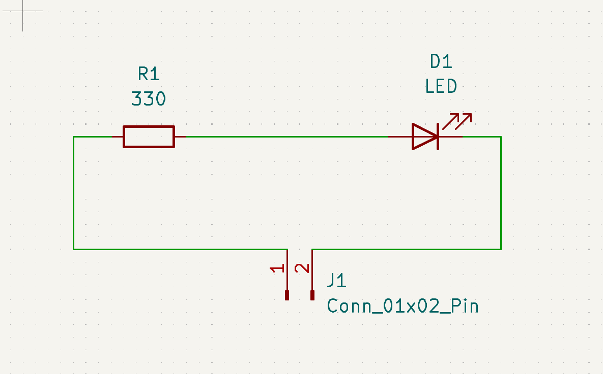
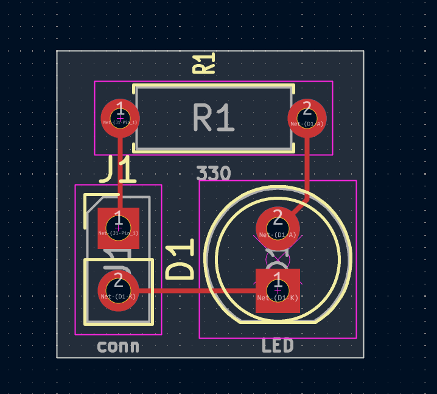
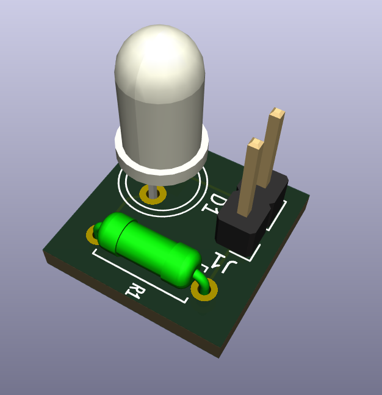

# Simple PCB Design | KiCad LED Indicator

## Project Overview

A simple LED indicator PCB designed using **KiCad**, featuring a 5 mm through-hole LED, a 330 Ω current-limiting resistor, and a 2-pin connector.

This project demonstrates schematic design, PCB layout, copper routing, and manufacturing file generation.

## Components

| Reference | Component | Specification |
|---|---|---|
| J1 | 2-Pin Connector | 2.54 mm pin header |
| R1 | Resistor | 330 Ω, through-hole |
| D1 | LED | 5 mm, through-hole |

## Software & Tools

- KiCad Schematic Editor
- KiCad PCB Editor
- KiCad Electrical Rules Checker (ERC)
- KiCad Design Rules Checker (DRC)
- KiCad Gerber Viewer
- KiCad 3D Viewer

## Schematic

## PCB Layout

## Gerber View

## 3D PCB View

## Project Files

| File | Description |
|---|---|
| `PCB_Learning.kicad_pro` | KiCad project configuration |
| `PCB_Learning.kicad_sch` | Circuit schematic |
| `PCB_Learning.kicad_pcb` | PCB layout and routing |

## Gerber & Drill Files

The following manufacturing files were generated using KiCad:

| File | Description |
|---|---|
| `PCB_Learning-Edge_Cuts.gbr` | PCB board outline |
| `PCB_Learning-F_Cu.gbr` | Front copper layer |
| `PCB_Learning-F_Mask.gbr` | Front solder mask |
| `PCB_Learning-F_Silkscreen.gbr` | Front silkscreen layer |
| `PCB_Learning-job.gbrjob` | Gerber job configuration |
| `PCB_Learning-PTH.drl` | Plated through-hole drill data |
| `PCB_Learning-NPTH.drl` | Non-plated through-hole drill data |

## Design Workflow

1. Created the circuit schematic in KiCad.
2. Added the connector, resistor, and LED.
3. Assigned through-hole footprints to the components.
4. Transferred the schematic components to the PCB Editor.
5. Arranged the components on the board.
6. Created the PCB outline using the `Edge.Cuts` layer.
7. Routed the copper tracks.
8. Performed ERC and DRC checks.
9. Generated Gerber and drill files.
10. Inspected the manufacturing layers using Gerber Viewer.
11. Visualized the PCB using KiCad 3D Viewer.

---

**Designed using KiCad | PCB Design Portfolio**
